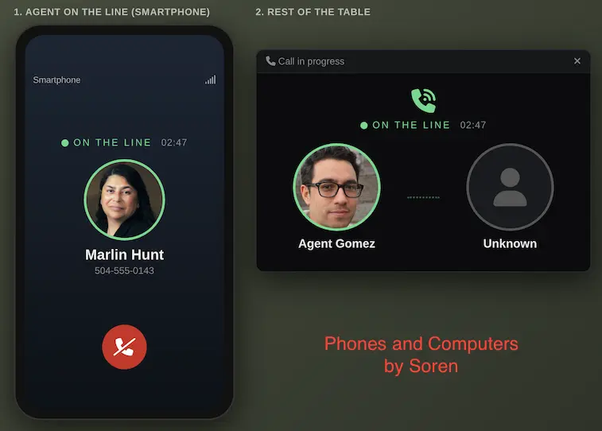
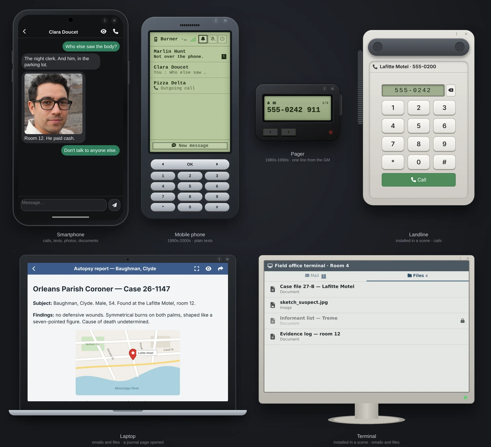
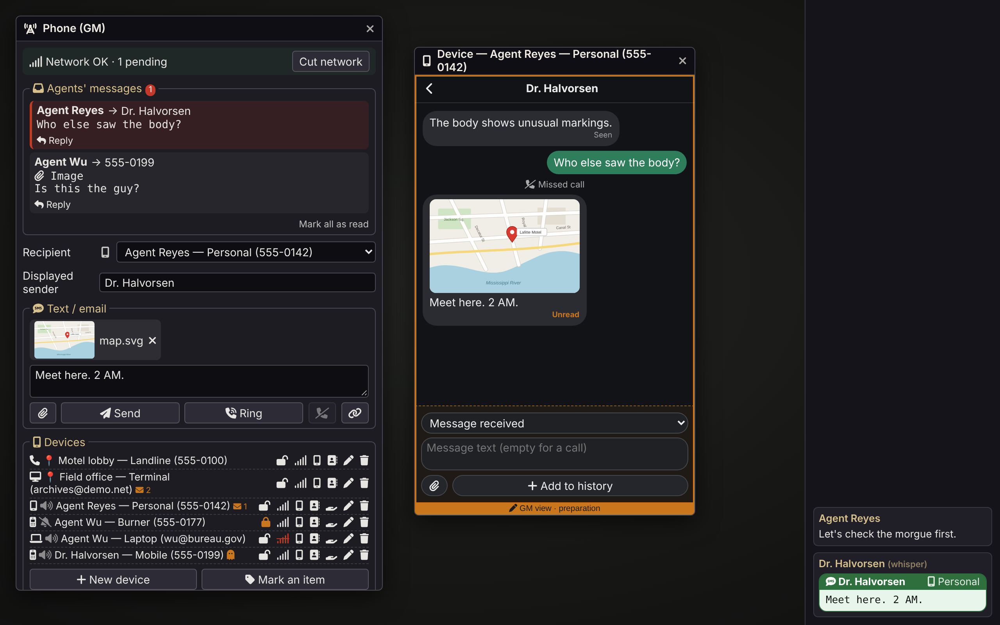

# Phones & Computers

*Le téléphone et l'ordinateur comme outils narratifs. Le réseau, c'est vous.*

*Pour les jeux d'enquête de toutes les époques : L'Appel de Cthulhu, Delta Green, Vampire, Blade Runner, Alien.*

Un module Foundry VTT qui donne aux personnages des téléphones, des ordinateurs portables et des terminaux installés dans les lieux. Chaque appel ou message vers un PNJ arrive chez le MJ, qui répond, laisse sonner ou décide que le numéro n'existe pas. Pensé pour l'enquête et le jeu narratif, pas comme un simulateur de smartphone.

- **Ctrl+Shift+P** ouvre le panneau MJ, ou le téléphone du joueur. Il y a aussi des boutons flottants.
- **Rien à configurer :** le MJ peut tout de suite appeler un joueur ou lui écrire ; un téléphone est créé pour son personnage si besoin.
- **Les agents communiquent entre eux** directement, sans le MJ. Rien ne passe jamais par le chat.
- **Pas d'horloge :** aucune date ni heure n'est affichée, pour ne jamais contredire la fiction.
- Foundry VTT v13 et v14. N'importe quel système de jeu. Français et anglais.



> **Le MJ doit être connecté.** Son navigateur fait office de réseau. Sans MJ en ligne, les joueurs relisent leurs messages mais ne peuvent ni écrire ni appeler.

[English version](README.md)

---

## Idées pour votre table

- **Un contact qui rappelle**, ou ne rappelle jamais.
- **Un téléphone volé.** Verrouillez-le, déverrouillez-le quand le jet réussit, remettez-le à un autre personnage avec tout son historique.
- **Un indice préparé.** Écrivez à l'avance l'historique d'un appareil : messages, photos, appels manqués.
- **Un terminal dans une pièce**, consulté par ceux qui s'y trouvent.
- **Un dossier à distance.** Un terminal partagé avec plusieurs joueurs, accessible de n'importe où, ses fichiers sensibles verrouillés jusqu'à ce que les agents trouvent le mot de passe.
- **Montrer plutôt que raconter.** Un joueur montre son écran aux agents dans la même pièce, ou transfère la photo.
- **Un scénario prêt à jouer.** Les liens `@SMS` et `@Call` dans un journal envoient un message ou font sonner un téléphone d'un clic.

---

## Installation

Dans Foundry : **Modules complémentaires → Installer un module**, puis collez l'URL du manifeste :

```
https://github.com/Dispositif/foundry-phones-computers/releases/latest/download/module.json
```

Pour l'essayer sur un monde vide, lancez `game.modules.get("soren-phones-computers").api.demo()` dans une macro MJ (`api.removeDemo()` fait le ménage).

**Mise à jour depuis Phone & Terminal (v0.29 et avant) :** installez ce module, activez-le à la place de l'ancien et rechargez. Appareils, historiques et réglages sont repris automatiquement.

---

## Appareils

Un appareil est un objet porté par un personnage, ou installé dans un lieu (une scène) et utilisé par ceux qui s'y trouvent. On le crée depuis le panneau MJ.

| Modèle | | Appels | Messages |
|---|---|---|---|
| **Smartphone** | porté | oui | SMS, photos, documents |
| **Téléphone mobile** (années 1990-2000) | porté | oui | SMS texte |
| **Bipeur** (années 1980-1990) | porté | non | une ligne du MJ |
| **Ordinateur portable** | porté | non | mails et fichiers |
| **Terminal** | installé | non | mails et fichiers |
| **Téléphone fixe** | installé | oui | non |



- **Habillages :** chaque modèle a le sien, plus quelques variantes : téléphone vintage à cadran, console texte verte, militaire, poste du FBI.
- **Fichiers** (portable, terminal) : glissez des pages de journal ou des images sur l'appareil. Les joueurs les lisent dans l'écran, sans accès à vos journaux Foundry. Chaque fichier peut être verrouillé ou masqué.
- **États :** silencieux ou éteint, verrouillé, sans réseau (aussi sur les scènes marquées zone blanche), compromis (sur écoute, visible du MJ seul).
- **Appareils partagés :** donnez un appareil de la barre Objets à plusieurs joueurs. Un terminal sans lieu devient une base de données qu'ils consultent de n'importe où.
- **Donner à…** passe un appareil à un autre personnage avec son numéro, ses contacts et son historique.

---

## Côté joueur

- Conversations par correspondant, réponses, appels, contacts. Un bip discret et une pastille à l'arrivée.
- **Montrer l'écran** aux agents dans la même pièce, ou **transférer** un message par le réseau.
- **Toute la table voit l'appel :** les portraits des agents, « Appel en cours… », puis qui est en ligne avec un chrono.
- Un petit bouton apparaît pour le fixe ou le terminal de la pièce où se trouve l'agent.

---

## Côté MJ



Le panneau **Réseau** (Ctrl+Shift+P, ou le bouton télécom) :

- **Envoyer :** faire sonner un appareil ou lui écrire sous n'importe quelle identité (PNJ, numéro, numéro masqué), avec une image ou une page de journal jointe.
- **Messages :** répondre aux messages des agents vers les PNJ ; lire leurs messages entre eux.
- **Appels :** tous les appels, leur issue et leur durée. Quand un agent appelle un PNJ, vous choisissez : décrocher, messagerie, pas de réponse, injoignable, numéro non attribué.
- **Appareils :** tous les appareils par porteur ou par lieu. Verrouiller, couper le réseau, donner, modifier, préparer l'historique.
- **Fichiers :** tous les fichiers des ordinateurs, par ordinateur ou par journal d'origine : visibles, verrouillés ou masqués.
- **Traçage** (expérimental) : avec quelle précision le réseau peut localiser chaque agent.
- **Couper le réseau** mobile pour tous, ou **couper la ligne** d'un appel en cours.

**Annuaire PNJ :** listez vos PNJ une fois, un par ligne (`Marlin Hunt | 555-0242`). Vous voyez qui les agents appellent, et les numéros `public` (pizzeria, taxi, hôpital) servent de pages jaunes aux joueurs.

**Liens dans les journaux :** `@SMS[destinataire|expéditeur]{texte}` et `@Call[destinataire|expéditeur]` deviennent des boutons dans vos notes de scénario. Le bouton lien du panneau les écrit pour vous. Les joueurs ne voient que le texte.

---

## Pour les développeurs

Chaque appareil est un objet Foundry ordinaire qui porte un seul flag, `flags["soren-phones-computers"].phone`. L'historique, les contacts et les fichiers y sont stockés : l'objet peut être dupliqué, déplacé ou placé dans un compendium avec ses données. Par exemple, un mobile jetable :

```json
{
  "model": "mobile", "label": "Burner", "number": "555-0177", "theme": "default",
  "mode": "on", "locked": false, "compromised": false, "noSignal": false, "sceneId": null,
  "contacts": [{ "name": "Marlin Hunt", "number": "555-0242" }],
  "log": [
    { "id": "k3Fq9aZ1", "t": 1762981200000, "kind": "sms", "dir": "in", "with": "555-0242", "text": "Not over the phone.", "read": false },
    { "id": "pL8wX2cD", "t": 1762980900000, "kind": "call", "call": "c7Hn2", "dir": "out", "with": "555-0242", "result": "answer", "dur": 74 }
  ]
}
```

- `model` : smartphone, mobile, pager, computer (portable), desktop (terminal), landline. Portables et terminaux ajoutent `files` et `inbox`.
- `log` va du plus récent au plus ancien, 200 entrées au plus (celles préparées par le MJ, `prep: true`, sont toujours gardées). `t` sert seulement à l'ordre, il n'est jamais affiché.
- `with` est le numéro du correspondant : le nom vient des contacts ou de l'annuaire PNJ à l'affichage.
- Pièces jointes et fichiers gardent une référence (`uuid` d'une page de journal, `src` d'une image), pas le contenu.
- Les réglages du monde contiennent le reste : annuaire PNJ, préfixe des numéros, coupure du réseau, appels en cours.

**Le navigateur du MJ est le réseau.** Les joueurs n'écrivent jamais directement dans les appareils : chaque message, appel ou accusé de lecture passe par le socket du module vers le MJ actif, qui vérifie et écrit. Le contenu d'un journal affiché sur un appareil est rendu par le MJ et envoyé en HTML : les joueurs n'ont besoin d'aucun droit sur le journal.

**API** (`game.modules.get("soren-phones-computers").api`) : `openPanel({ tab })`, `openPhone(itemUuid)`, `ring(target, { caller })`, `sendSms(target, text, { sender, att })`, `hangUp(callId)`, `allPhones()`, `createPhone(actor, { label, number, model, sceneId })`, `markPhone(item, { label, number, model })`, `transferPhone(item, actor)`, `demo()`, `removeDemo()`. Une cible s'écrit `"phone:555-0142"` ou `"user:<userId>"`.
