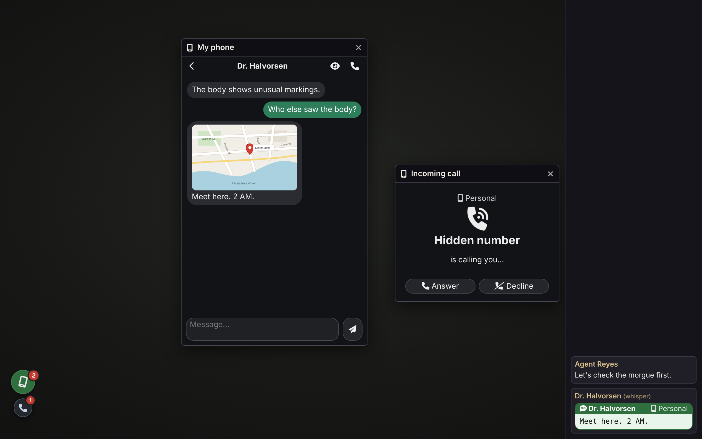
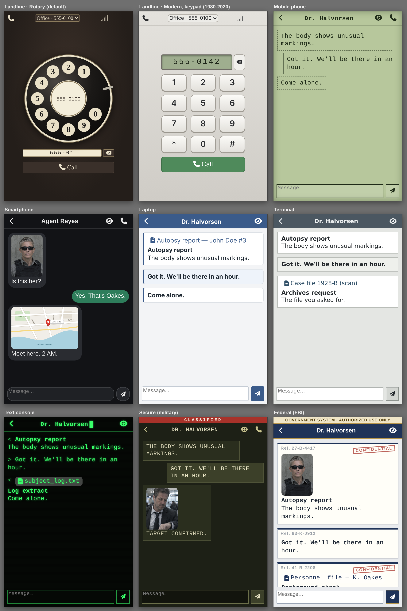
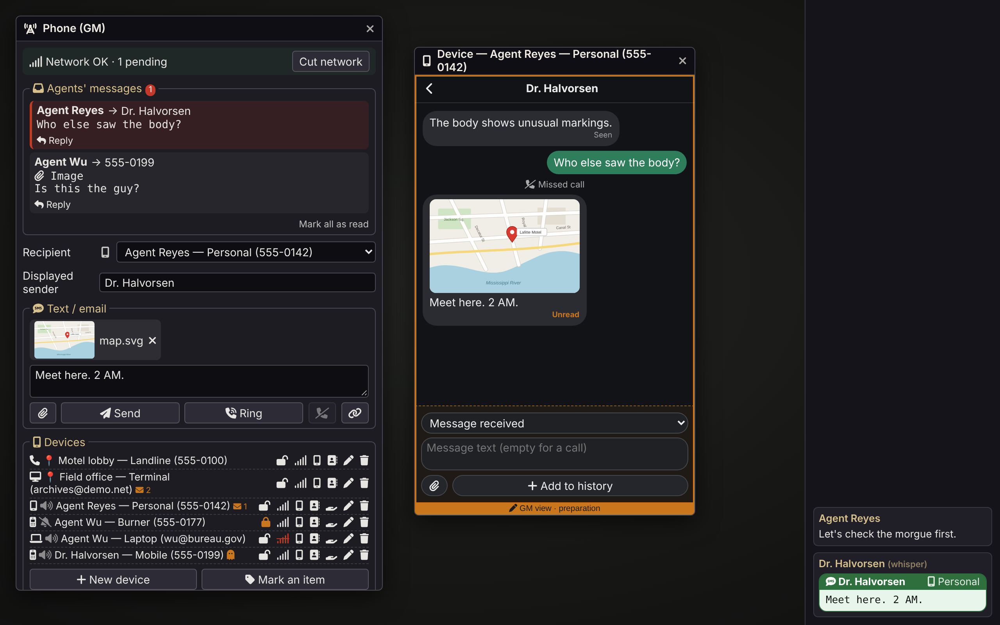

# Phone & Terminal

*Phones and computers as a storytelling tool. You are the network.*

A Foundry VTT module that gives your characters phones, laptops and room terminals. Every call or message to an NPC lands with the GM, who answers, lets it ring, or decides the number doesn't exist. Built for investigation and narrative play, not as a smartphone simulator.

- **No setup needed:** the GM can ring a player or send them a message right away, from the GM panel.
- **Devices are optional extras.** A device is an item in a character's inventory (phone, laptop), or is installed in a place: a landline or a terminal tied to a Foundry scene, used by whoever stands there. Devices bring history, contacts, replies, sharing and looks.
- **Agents talk to each other too.** With devices, characters call and text one another directly, without the GM stepping in; the GM gets a discreet copy of the messages.
- Foundry VTT v13 and v14. Any game system.
- Interface in English and French.



> **The GM must be connected.** The GM's browser acts as the network. Without a GM online, players see "No phone network [GM away]". They can read their messages but cannot write or call.

[Version française](README.fr.md)

---

## Principles

- **The GM is the network.** Everything sent to an NPC reaches the GM, who replies, picks up or lets it ring.
- **No clock.** No date or time is ever shown, so nothing contradicts your fiction's timeline. Message order is enough.
- **Few settings.** Sensible defaults rather than options.
- **Discretion.** Only the players concerned hear the ring or beep and see the message.

## Ideas for your table

- **A contact who calls back**, or never does.
- **A terminal in a room.** Anyone standing there reads its mail. Attach journal pages to simulate files: archives, logs, case reports.
- **A hack, a stolen phone.** Lock a device, unlock it when the roll succeeds. Hand it to another character with its whole history.
- **A prepared clue.** Write a device's history in advance: messages, photos, missed calls.
- **Show, don't tell.** A player shows their screen to the agents in the same room, or forwards the photo.

---

## Installation

In Foundry: **Add-on Modules → Install Module**, then paste the manifest URL:

```
https://github.com/Dispositif/foundry-phone-terminal/releases/latest/download/module.json
```

Enable **Phone & Terminal** in your world. To try it on an empty world, run this in a GM macro:

```js
game.modules.get("soren-phone-terminal").api.demo()
```

It creates a smartphone for each assigned character without a device, a landline and a terminal on the current scene, and an NPC mobile with a prepared message. To remove them all:

```js
game.modules.get("soren-phone-terminal").api.removeDemo()
```

---

## Devices

### Without any device

The GM can ring a player or send them a message (choose the player in **Recipient**). The call window or the message reaches only that player, in the chat. No history, no reply: to let players write back and keep a history, give them a device.

### A device is an item

- A **carried device** is an item in a character's inventory. An **installed device** (landline, terminal) is tied to a Foundry scene.
- Any item can become a device: create one from the GM panel (**New device**) or turn an existing item into one (**Mark an item**).
- Each device has a **model**, a **name** ("personal", "burner", "office"…; defaults to the model name) and a **number** (or an email address for computers).
- A character can carry several devices.

### Models

| Model | Carried / installed | Calls | Messages | Attachments | Caller ID |
|---|---|---|---|---|---|
| **Smartphone** | carried | yes | texts | yes | yes |
| **Mobile phone** (1990s-2000s) | carried | yes | plain texts | no | yes |
| **Laptop** | carried | no | emails | yes | yes |
| **Terminal** | installed in a scene | no | emails | yes | yes |
| **Landline** | installed in a scene | yes | no | no | no |

- **Emails:** the first line acts as the subject. Emails work even when text messages are disabled.
- **Installed devices** (landline, terminal) are bound to a scene and don't depend on the mobile network. Only their own "no signal" toggle cuts them off.

### Looks



- Each model has its own look: dark rounded smartphone, green LCD mobile, light mail client for the laptop, grey office workstation for the terminal, and black Bakelite with a rotary dial for the landline (1920s to 1980s).
- The GM can pick another look per device (**Edit device**), among those that fit the model:
  - landline: **Modern, keypad** (1980-2020: small display, push buttons);
  - phones and computers: **Text console** (green phosphor on black, text only) or **Secure (military)** (khaki, upper case, "Classified" banner);
  - laptop and terminal: **Federal (FBI)**, a navy and gold government workstation, emails shown as case files with a reference and a "Confidential" stamp, and an "Identification required" lock screen.
- Every device stores its look ("default" means the model's look). A look removed or renamed in a future version falls back to the model's look.
- The incoming call window uses the look of the ringing device, and so does the GM view of a device, with an orange "GM view · preparation" border.

### Who holds the device?

- **Carried device:** the player whose assigned character carries it; otherwise the character's owners. Assign a character to each player, or a player who owns several characters would see their devices too.
- **Installed device:** every agent with a token on the scene; otherwise the players viewing the scene. The device appears and disappears from their window as they move.
- **Held by nobody** (world item, or NPC): nobody picks up. Handy to prepare a phone in advance.

### Changing hands

- **Give to…** passes the device to another character, an NPC or nobody, with its number, contacts and history (a seized phone, a phone handed over by a contact…).
- **Duplicating the item** gives a **cloned SIM**: both devices share the number and both ring. The GM panel flags it with an icon.

---

## Player side

### Opening the phone

- **Ctrl+Shift+P** (rebindable) opens "My phone" (or "My devices").
- The **floating button** (if enabled by the GM):
  - always visible, draggable, position remembered;
  - red badge with the number of unread messages;
  - shakes when the phone rings;
  - opens the last personal device used.
- In a room with a landline or a terminal, a **small room button** appears under the phone, with its own unread count. It shakes when the landline rings, opens the room's device, and disappears when the agent leaves.
- With several devices, the window reopens on the **last device used**. If it is out of reach (room left, device given away), it falls back to a personal device and says so.

### Messages

- Conversations by correspondent, most recent first, with unread counts.
- Opening a conversation marks it as read.
- **Reply**, **write a new message** or **call** from a conversation. Enter sends, Shift+Enter adds a line.
- A hidden number can't be answered or called back.
- A discreet beep on arrival (a mail sound for computers), and a private copy in the chat.

### Sharing

- **Show the screen** (eye icon, on a message or at the top of a conversation): the agent hands the device to the agents on the same scene. They see the image, the journal page (its content, without needing read permission) or the conversation, in a "X shows you their screen" window. Nothing remains once it is closed. Works without network. The GM is notified.
- **Forward** (arrow icon, on a message): the message and its attachment go out over the network to a contact or a number, like a real message (network needed, kept in the history, copy to the GM). An agent recipient automatically gets permission to read the attached journal; an NPC recipient lands in the GM's inbox. The message is marked "Forwarded". An old mobile forwards text only.

### Calls

- An incoming call shows the caller (except on a landline) with **Answer** / **Decline**. Distinct sounds for the ring (per model), pick-up and hang-up.
- No answer within the GM's delay: missed call.
- The **landline** is only a dial. Click a finger hole to dial a digit (the dial turns), or type the number. Enter places the call. No history, no call list, no contacts.

### Modes

- Normal, **silent** (no ring or beep) or **off** (calls missed, messages received without a beep).
- No modes on installed devices, since they are shared.

### Device states

- **No signal:** no writing or calling. Messages and missed calls wait and all arrive when the signal comes back, with a summary.
- **Locked:** a lock screen with the unread count. Messages arrive with their sender, but their text stays hidden. Calls ring normally.

---

## Communications

### GM to agent

- The GM rings a device or sends it a message, under any identity: an NPC name, a number, or "Hidden number".
- Recipient: a specific device, a number, or a player.
- **Attachments** (smartphone, laptop, terminal): an image (paperclip, or drag a tile) or a journal page dragged from the sidebar. The recipient automatically gets permission to read it.

### Agent to NPC

- **Message:** it lands in the GM panel's **Agents' messages** inbox. **Reply** pre-fills the answer.
- **Call:** the GM hears the ring and picks the outcome: **Answer**, **Voicemail**, **No answer**, **Unreachable** or **Not in service**.

### Agent to agent

- Calls ring the other agent's phone directly, without the GM.
- Messages are delivered directly, with a discreet copy to the GM.

### Contacts

- The address book builds up in play: anyone who wrote or called appears.
- The GM can give contacts to a device, one per line: `Name | number` (number optional).
- Numbers are compared without dashes, spaces, dots or brackets: `555-0133` is `5550133`.

---

## GM side



### The GM panel (Ctrl+Shift+P)

- Send area: recipient (with the model's icon), displayed sender, message or call, attachment.
- **Ring**, **Hang up**, **Send**, and **Copy as a link** to paste into a journal.
- **Agents' messages** inbox.
- **Cut network** toggle for the whole mobile network.
- **Devices** list. Click a device to make it the recipient. For each one:
  - model icon, mode, holder or place, number of messages the player hasn't read;
  - flags: cloned number, held by nobody;
  - actions: open and prepare history, contacts, lock, no signal, give to…, edit, remove.

### Preparing a device

- Open any device, even one held by an NPC or by nobody.
- Write its history (texts or emails received and sent, calls received, made or missed), attachments included, without sending or notifying anyone.
- Delete any message or call.

### Read receipts

- In the GM view of a device, each received message shows **Seen**, **Unread** or **Pending** (not delivered yet, no signal).
- Players never see these.

### Journal links

- In your scenario notes, `@SMS[recipient|sender]{text}` and `@Call[recipient|sender]` become buttons: one click sends the message or rings the device.
- The recipient can be a number, a character name or a player name; the sender is optional. Attachments with `img:` or `doc:`.
- No need to remember the syntax: the GM panel's link button copies the link for what you typed.
- Players never see these buttons, only the text.

---

## Settings

| Setting | Scope | Effect |
|---|---|---|
| Phone volume | each player | ringtone and beep |
| Ring duration | world | seconds before a missed call; 0 rings until answered |
| Text messages | world | uncheck for an era without texts: calls and emails remain |
| Floating button for players | world | shows or hides the players' button |
| Open shortcut | each player | Ctrl+Shift+P by default |
| Module language | world | Automatic (each player's Foundry language), English or Français. Reloads the page. |

---

## Updating

- Updates go through Foundry's module manager.
- During development, after changing files: **Cmd+Shift+R** (Ctrl+Shift+R on Windows) for the GM and each player, and relaunch the world if `module.json` changed.
- Data from earlier versions (Burner Phone `soren-burner-phone`, `dg-telephone`) is migrated automatically on load: devices, histories and world settings. Disable the old module before enabling this one.

---

## License and credits

By Soren. Released under the [MIT License](LICENSE).
