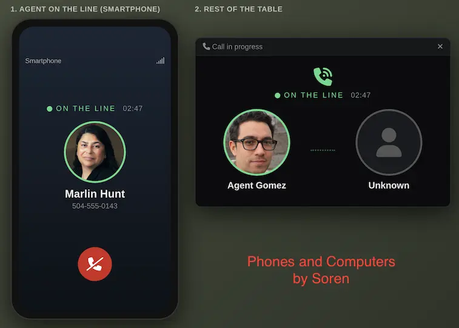
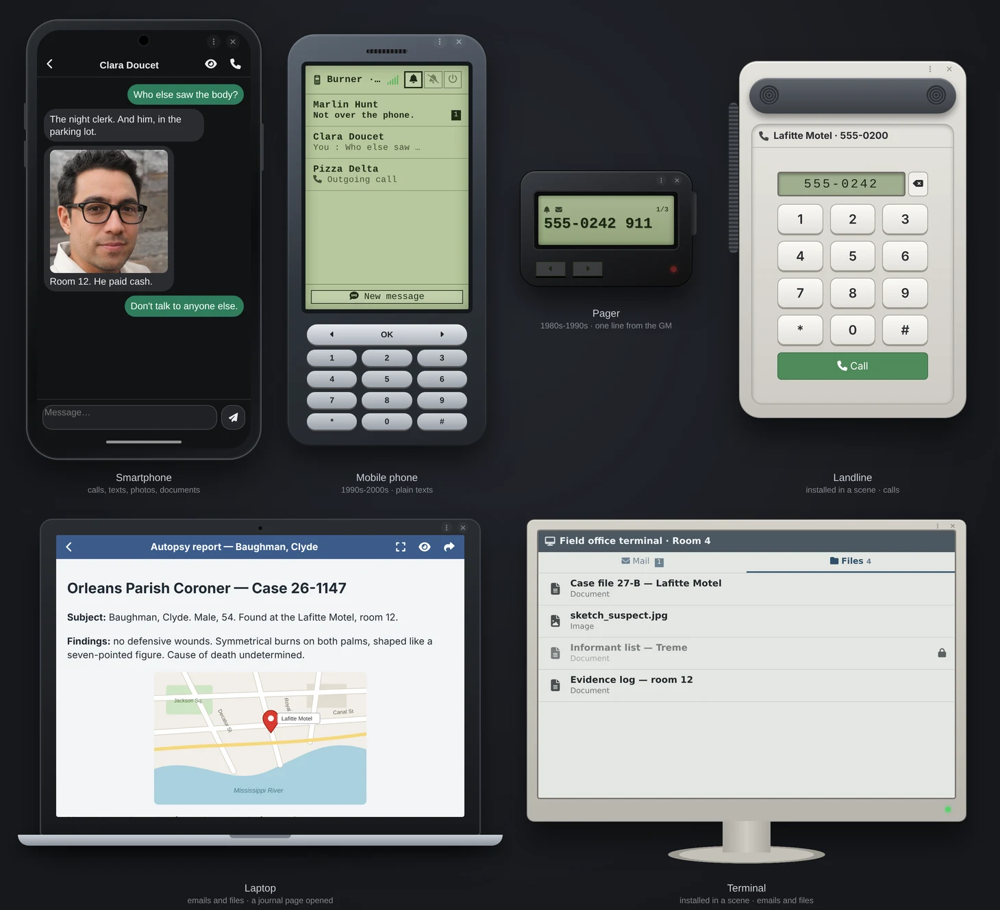

# Phones & Computers

*Phones and computers as a storytelling tool. You are the network.*

*For investigation games of any era: Call of Cthulhu, Delta Green, Vampire, Blade Runner, Alien.*

A Foundry VTT module that gives your characters phones, laptops and room terminals. Every call or message to an NPC lands with the GM, who answers, lets it ring, or decides the number doesn't exist. Built for investigation and narrative play, not as a smartphone simulator.

- **Ctrl+Shift+P** opens the GM panel, or the player's phone. Floating buttons too.
- **No setup needed:** the GM can ring a player or text them right away; a phone is created for their character if needed.
- **Agents talk to each other** directly, without the GM. Nothing ever goes to the chat.
- **No clock:** no date or time is ever shown, so nothing contradicts your fiction.
- Foundry VTT v14. Any game system. English and French.



> **The GM must be connected.** The GM's browser acts as the network. Without a GM online, players can read their messages but cannot write or call.

[Version française](README.fr.md)

---

## Ideas for your table

- **A contact who calls back**, or never does.
- **A stolen phone.** Lock it, unlock it when the roll succeeds, hand it to another character with its whole history.
- **A prepared clue.** Write a device's history in advance: messages, photos, missed calls.
- **A terminal in a room**, read by whoever stands there.
- **A remote case file.** A terminal shared with several players, reachable from anywhere, its sensitive files locked until the agents find the password.
- **Show, don't tell.** A player shows their screen to the agents in the same room, or forwards the photo.
- **A ready-to-play scenario.** `@SMS` and `@Call` links in a journal send a message or ring a phone in one click.

---

## Installation

In Foundry: **Add-on Modules → Install Module**, then paste the manifest URL:

```
https://github.com/Dispositif/foundry-phones-computers/releases/latest/download/module.json
```

To try it on an empty world, run `game.modules.get("soren-phones-computers").api.demo()` in a GM macro (`api.removeDemo()` cleans up).

**Upgrading from Phone & Terminal (v0.29 and earlier):** install this module, enable it instead of the old one and reload. Devices, histories and settings are moved over automatically.

---

## Devices

A device is an item carried by a character, or installed in a place (a scene) and used by whoever stands there. Create one from the GM panel.

| Model | | Calls | Messages |
|---|---|---|---|
| **Smartphone** | carried | yes | texts, photos, documents |
| **Mobile phone** (1990s-2000s) | carried | yes | plain texts |
| **Pager** (1980s-1990s) | carried | no | one line from the GM |
| **Laptop** | carried | no | emails and files |
| **Terminal** | installed | no | emails and files |
| **Landline** | installed | yes | no |



- **Looks:** each model has its own, plus a few alternatives: vintage rotary phone, green text console, military, FBI workstation.
- **Files** (laptop, terminal): drop journal pages or images on the device. Players read them inside the screen, without access to your Foundry journals. Lock or hide each file.
- **States:** silent or off, locked, no signal (also on scenes marked as dead zones), compromised (tapped, GM only).
- **Shared devices:** give a device from the Items sidebar to several players. A terminal with no location becomes a database they reach from anywhere.
- **Give to…** passes a device to another character with its number, contacts and history.

---

## Player side

- Conversations by correspondent, replies, calls, contacts. A discreet beep and a badge on arrival.
- **Show the screen** to the agents in the same room, or **forward** a message over the network.
- **The whole table sees the call:** the agents' portraits, "Calling…", then who is on the line with a timer.
- A small button appears for the landline or terminal of the room the agent stands in.

---

## GM side


The **Network** panel (Ctrl+Shift+P, or the telecom button):

- **Send:** ring a device or text it under any identity (NPC, number, hidden number), with an image or a journal page attached.
- **Messages:** answer the agents' messages to NPCs; read their messages to each other.
- **Calls:** every call, its outcome and duration. When an agent calls an NPC, you choose: answer, voicemail, no answer, unreachable, not in service.
- **Devices:** every device by holder or place. Lock, no signal, give, edit, prepare its history.
- **Files:** every computer file, by computer or by source journal: visible, locked or hidden.
- **Tracking** (experimental): how precisely the network can locate each agent.
- **Cut network** for the whole mobile network, or **cut the line** of any call in progress.

**NPC directory:** list your NPCs once, one per line (`Marlin Hunt | 555-0242`). You see who the agents call, and `public` numbers (pizzeria, taxi, hospital) work as yellow pages for the players.

**Journal links:** `@SMS[recipient|sender]{text}` and `@Call[recipient|sender]` become buttons in your scenario notes. The panel's link button writes them for you. Players see only the text.

---

## For developers

Each device is an ordinary Foundry item carrying one flag, `flags["soren-phones-computers"].phone`. History, contacts and files live there, so the item can be duplicated, moved or put in a compendium with its data. A burner mobile, for instance:

```json
{
  "model": "mobile", "label": "Burner", "number": "555-0177", "theme": "default",
  "mode": "on", "locked": false, "compromised": false, "noSignal": false, "sceneId": null,
  "contacts": [{ "name": "Marlin Hunt", "number": "555-0242" }],
  "log": [
    { "id": "k3Fq9aZ1", "t": 1762981200000, "kind": "sms", "dir": "in", "with": "555-0242", "text": "Not over the phone.", "read": false },
    { "id": "pL8wX2cD", "t": 1762980900000, "kind": "call", "call": "c7Hn2", "dir": "out", "with": "555-0242", "result": "answer", "dur": 74 }
  ]
}
```

- `model`: smartphone, mobile, pager, computer (laptop), desktop (terminal), landline. Laptops and terminals add `files` and `inbox`.
- `log` is newest first, 200 entries max (GM-prepared ones, `prep: true`, are always kept). `t` only orders entries; it is never shown.
- `with` is the other end's number: names come from contacts or the NPC directory when displayed.
- Attachments and files hold a reference (`uuid` for a journal page, `src` for an image), not the content.
- World settings hold the rest: NPC directory, number prefix, network cut, calls in progress.

**The GM's browser is the network.** Players never write to devices directly: every message, call and read receipt goes through the module socket to the active GM, who checks and writes. Journal content shown on a device is rendered by the GM and sent as HTML, so players need no journal permission.

**API** (`game.modules.get("soren-phones-computers").api`): `openPanel({ tab })`, `openPhone(itemUuid)`, `ring(target, { caller })`, `sendSms(target, text, { sender, att })`, `hangUp(callId)`, `allPhones()`, `createPhone(actor, { label, number, model, sceneId })`, `markPhone(item, { label, number, model })`, `transferPhone(item, actor)`, `demo()`, `removeDemo()`. A target is `"phone:555-0142"` or `"user:<userId>"`.
