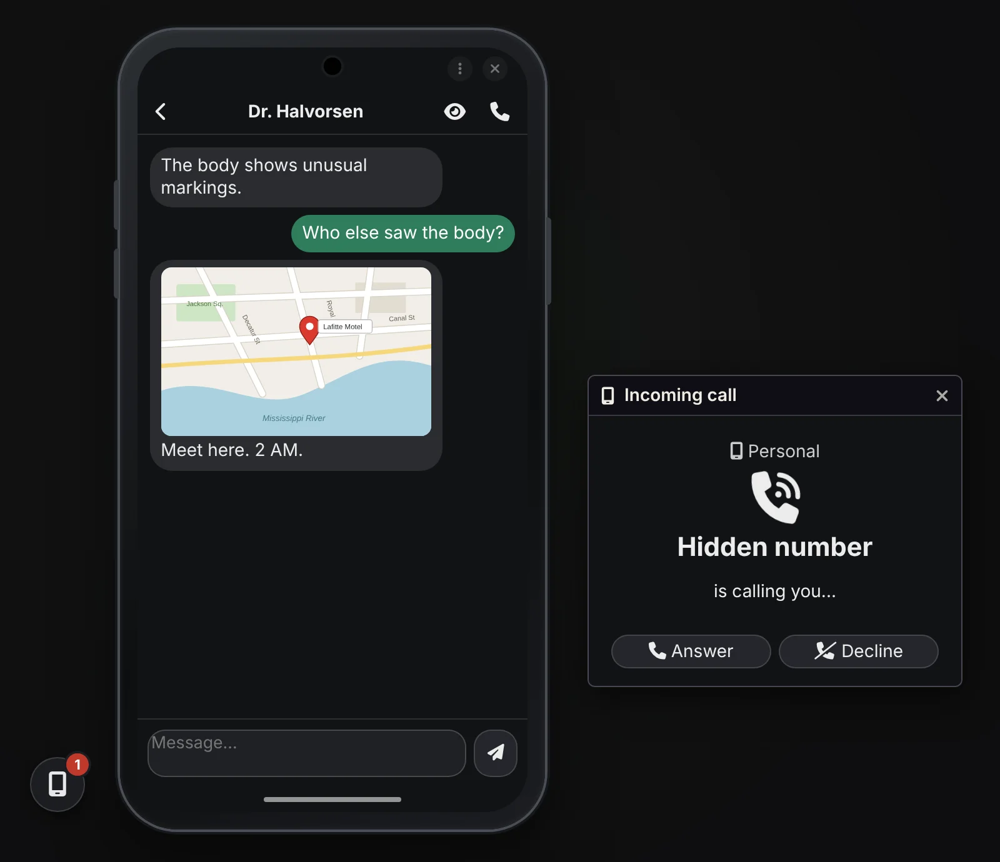
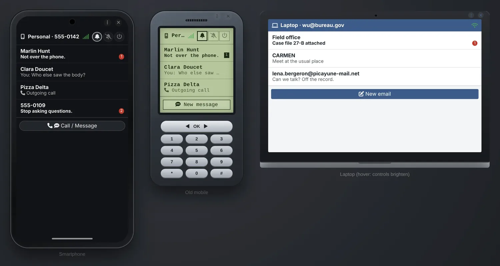
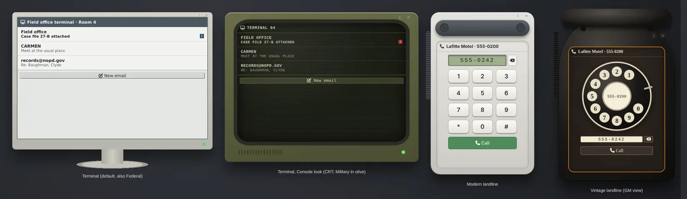

# Phones & Computers

*Phones and computers as a storytelling tool. You are the network.*

*For investigation games of any era: Call of Cthulhu, Delta Green, Vampire, Blade Runner, Alien.*

A Foundry VTT module that gives your characters phones, laptops and room terminals. Every call or message to an NPC lands with the GM, who answers, lets it ring, or decides the number doesn't exist. Built for investigation and narrative play, not as a smartphone simulator.

- **One shortcut: Ctrl+Shift+P** opens the GM panel, or the player's phone. Players get a floating phone button, the GM a telecom one with the unread count.
- **No setup needed:** the GM can ring a player or send them a message right away, from the GM panel.
- **Devices are optional extras.** A device is an item in a character's inventory (phone, laptop), or is installed in a place: a landline or a terminal tied to a Foundry scene, used by whoever stands there. Devices bring history, contacts, replies, sharing and looks.
- **Agents talk to each other too.** With devices, characters call and text one another directly, without the GM stepping in; the GM gets a discreet copy of the messages.
- **NPC directory:** list your NPCs once, name and number. You see at a glance who the agents are calling, and public numbers (pizzeria, taxi, hospital) work as yellow pages for the players.
- Foundry VTT v13 and v14. Any game system.
- Interface in English and French.
- **Manifest URL:** `https://github.com/Dispositif/foundry-phones-computers/releases/latest/download/module.json`



> **The GM must be connected.** The GM's browser acts as the network. Without a GM online, players see "No phone network [GM away]". They can read their messages but cannot write or call.

[Version française](README.fr.md)

---

## Principles

- **The GM is the network.** Everything sent to an NPC reaches the GM, who replies, picks up or lets it ring.
- **No clock.** No date or time is ever shown, so nothing contradicts your fiction's timeline. Message order is enough.
- **Few settings.** Sensible defaults rather than options.
- **Discretion.** Only the players concerned hear the ring or beep and see the message.

## Ideas for your table

- **A contact who calls back**, or never does.
- **A terminal in a room.** Anyone standing there reads its mail. Attach journal pages to simulate files: archives, logs, case reports.
- **A hack, a stolen phone.** Lock a device, unlock it when the roll succeeds. Hand it to another character with its whole history.
- **A ready-to-play scenario.** `@SMS` and `@Call` links in a journal send a message or ring a phone in one click.
- **A remote case file.** A terminal in the Items sidebar, with "Observer" permission for several players: they reach its mail from anywhere, like a secure FBI database. Attach journal pages as files.
- **A prepared clue.** Write a device's history in advance: messages, photos, missed calls.
- **Show, don't tell.** A player shows their screen to the agents in the same room, or forwards the photo.

---

## Installation

In Foundry: **Add-on Modules → Install Module**, then paste the manifest URL:

```
https://github.com/Dispositif/foundry-phones-computers/releases/latest/download/module.json
```

Enable **Phones & Computers** in your world. To try it on an empty world, run this in a GM macro:

```js
game.modules.get("soren-phones-computers").api.demo()
```

It creates a smartphone for each assigned character without a device, a landline and a terminal on the current scene, and an NPC mobile with a prepared message. To remove them all:

```js
game.modules.get("soren-phones-computers").api.removeDemo()
```

**Upgrading from Phone & Terminal (`soren-phone-terminal`, v0.29 and earlier).** The module changed its id, so Foundry sees a new module. Install it with the same manifest URL, enable it instead of the old one and reload the world: devices, histories, contacts, settings and the NPC directory are moved over automatically. Then uninstall the old module.

---

## Devices

### Without any device

The GM can ring a player or send them a message (choose the player in **Recipient**). The call window or the message reaches only that player, in a small window on their screen (never in the chat). No history, no reply: to let players write back and keep a history, give them a device.

### A device is an item

- A **carried device** is an item in a character's inventory. An **installed device** (landline, terminal) is tied to a Foundry scene.
- Create a device from the GM panel (**New device**).
- Each device has a **model**, a **name** ("personal", "burner", "office"…; defaults to the model name; it is also the item's name) and a **number** (or an email address for computers).
- A character can carry several devices.
- Clicking a device item opens the device itself. The GM reaches the system's item sheet from the device view.
- The item gets the model's icon and a short description (model and number), unless you chose your own.

### Models

| Model | Carried / installed | Calls | Messages | Attachments | Caller ID |
|---|---|---|---|---|---|
| **Smartphone** | carried | yes | texts | yes | yes |
| **Mobile phone** (1990s-2000s) | carried | yes | plain texts | no | yes |
| **Pager** (1980s-1990s) | carried | no | receives one line, from the GM | no | no |
| **Laptop** | carried | no | emails | yes | yes |
| **Terminal** | installed in a scene | no | emails | yes | yes |
| **Landline** | installed in a scene | yes | no | no | no |

- **Emails:** the first line acts as the subject.
- **Pager:** one line of 12 characters (a number to call back, a code, a word), sent by the GM from the Send tab; longer text is cut. It beeps (buzzes in silent mode) and its window opens by itself next to the phone; ◀ ▶ browse the history, the red light stays on until a key is pressed. A message an agent writes to a pager number reaches the GM. Click the bell on its screen to switch on, silent or off.
- **Installed devices** (landline, terminal) are bound to a scene and don't depend on the mobile network: they always have a line.

### Looks





- Each model has its own look: dark rounded smartphone, green LCD mobile, light mail client for the laptop, grey office workstation for the terminal, and a keypad phone for the landline (1980-2020: small display, push buttons).
- The GM can pick another look per device (**Edit device**), among those that fit the model:
  - landline: **Vintage, rotary dial** (1920-1980: black Bakelite);
  - phones and computers: **Text console** (green phosphor on black, text only) or **Secure (military)** (khaki, upper case, "Classified" banner);
  - laptop and terminal: **Federal (FBI)**, a navy and gold government workstation, emails shown as case files with a reference and a "Confidential" stamp, and an "Identification required" lock screen.
- Every device stores its look ("default" means the model's look). A look removed or renamed in a future version falls back to the model's look.
- Each device is drawn as the real thing around its screen: smartphone, old mobile with a decorative keypad, laptop, terminal monitor (a CRT for the Console and Military looks), desk phone or bakelite rotary phone. The Foundry title bar gives way to two discreet buttons on the top edge (menu, close); drag the window from there. The GM view uses the same frame.
- The incoming call window uses the look of the ringing device, and so does the GM view of a device, with an orange "GM view · preparation" border.

### Who holds the device?

- **Carried device:** the player whose assigned character carries it; otherwise the character's owners. Assign a character to each player, or a player who owns several characters would see their devices too.
- **Installed device:** every agent with a token on the scene; otherwise the players viewing the scene. The device appears and disappears from their window as they move.
- **Shared access:** a device in the Items sidebar is held by the players you give it to (Observer or Owner), wherever they are. An installed one stays usable on its scene too.
- **Held by nobody** (world item given to no one, or NPC): nobody picks up. Handy to prepare a phone in advance.
- **Landline in an empty room:** an agent's call rings the GM instead ("Call to an empty landline", with the place), who answers for whoever is there.

### Changing hands

- **Give to…** passes the device to another character, an NPC or nobody, with its number, contacts and history (a seized phone, a phone handed over by a contact…).
- **Dragging the item** onto another character does the same: a carried device exists only once. Duplicating it where it is gives a new device with its own number.

---

## Player side

### Opening the phone

- **Ctrl+Shift+P** (rebindable) opens "My phone" (or "My devices").
- The **floating button** (if enabled by the GM):
  - always visible, draggable, position remembered;
  - red badge with the number of unread messages;
  - shakes when the phone rings;
  - opens the last personal device used.
- In a room with a landline or a terminal, a **small room button** appears under the phone, with its own unread count. It shakes when the landline rings, opens the room's device, and disappears when the agent leaves. A shared device used from elsewhere gets no button: open it with Ctrl+Shift+P or from the Items sidebar.
- With several devices, the window reopens on the **last device used**. If it is out of reach (room left, device given away), it falls back to a personal device and says so.

### Messages

- Conversations by correspondent, most recent first, with unread counts.
- Opening a conversation marks it as read.
- **Reply**, **write a new message** or **call** from a conversation. Enter sends, Shift+Enter adds a line.
- A hidden number can't be answered or called back.
- A discreet beep on arrival (a mail sound for computers) and a badge on the floating button. Messages never appear in the players' chat: they are read on the device.

### Sharing

- **Show the screen** (eye icon, on a message or at the top of a conversation): the agent hands the device to the agents on the same scene. They see the image, the journal page (its content, without needing read permission) or the conversation, in a "X shows you their screen" window. Nothing remains once it is closed. Works without network. The GM is notified.
- **Forward** (arrow icon, on a message): the message and its attachment go out over the network to a contact or a number, like a real message (network needed, kept in the history, copy to the GM). An agent recipient automatically gets permission to read the attached journal; an NPC recipient lands in the **Messages** tab of the GM panel. The message is marked "Forwarded". An old mobile forwards text only.

### Calls

- An incoming call shows the caller with **Answer** / **Decline**; a Modern landline shows only a number, a Vintage one nothing. Distinct sounds for the ring (per model), pick-up and hang-up.
- When an agent's phone rings (ring mode), every other player hears it softly, with a small notice ("Reyes's phone is ringing"). Narration over realism: the whole table knows.
- When an agent places a call, they hear a ringback tone; every other player hears it too, softly, with a notice ("Reyes has an ear to the phone"). Between two agents, everyone just hears the ringing phone.
- No answer within the GM's delay: missed call.
- The **landline** is only a keypad (or a rotary dial in Vintage). Click to dial a digit (in Vintage, the dial turns), or type the number. Enter places the call. No history, no call list, no contacts.

### Modes

- Normal, **silent** (no ring or beep; an incoming call only buzzes for its holder) or **off** (calls missed, messages received without a beep; the screen stays dark, with a **Switch on** button).
- Laptops and terminals have no modes: they are always on.
- No modes on installed devices, since they are shared.

### Device states

- **No signal:** no writing or calling. Messages and missed calls wait and all arrive when the signal comes back, with a summary.
- **Locked:** a lock screen with the unread count. Messages arrive with their sender, but their text stays hidden. Calls ring normally.

---

## Communications

### GM to agent

- The GM rings a device or sends it a message, under any identity: an NPC name, a number, or "Hidden number".
- Recipient: a specific device, a number, or a player.
- **Attachments** (smartphone, laptop, terminal): an image (paperclip, or drag a tile) or a journal page dragged from the sidebar. The recipient automatically gets permission to read it.

### Agent to NPC

- **Message:** it lands in the **Messages** tab of the GM panel, where the GM replies in the thread.
- **Call:** the GM hears the ring and picks the outcome: **Answer**, **Voicemail**, **No answer**, **Unreachable** or **Not in service**.

### Agent to agent

- Calls ring the other agent's phone directly, without the GM.
- Messages are delivered directly, with a discreet copy to the GM.

### Contacts

- The address book builds up in play: anyone who wrote or called appears.
- The GM can give contacts to a device, one per line: `Name | number` (number optional).
- The player edits the address book of a personal device they hold (address book icon), and names an unknown correspondent from the conversation (person icon). Landlines, terminals and shared devices stay in the GM's hands.
- Numbers are compared without dashes, spaces, dots or brackets: `555-0133` is `5550133`.

---

## GM side


### The GM panel: Network (Ctrl+Shift+P)

- The GM's **floating telecom button** opens it (on **Messages** when agents' messages are unread) and shows their count. It has its own setting.
- Top bar: network status, pending messages, and a **Cut network** toggle for the whole mobile network.
- **Send** tab: recipient (with the model's icon), displayed sender (free text, hidden number when empty, with suggestions: the recipient's contacts, recent senders, other devices' numbers), then **Message** or **Call**. Only what the recipient can do is offered (no message to a landline, no call to a terminal). **Send** or **Ring**, attachment, and **Copy as a link** to paste into a journal.
- **Messages** tab: one thread per agent and NPC, as chat bubbles. Reply right under the thread (Enter sends), or call the agent back.
- **Devices** tab, grouped by holder (character portrait) or place (scene thumbnail). Click a device to make it the recipient. For each one:
  - model icon, mode, number of messages the player hasn't read;
  - flags: shared number, locked, no signal;
  - actions on hover: open and prepare history, contacts, lock, no signal and give to… (carried devices), edit, remove (deletes the item, or keeps it as an ordinary item).

### NPC directory

- **Directory** button (Devices tab of the GM panel): one NPC per line, like contacts. Lines starting with `#` are titles.

  ```
  # Scenario
  Marlin Hunt | 555-0242
  # Public
  Pizza Delta | 555-0202 | public
  ```
- It starts with a New Orleans sample. Once you edit it, it is saved in your world and module updates never touch it.
- Tip: add the agents' own numbers with `| public` (`Agent Reyes | 555-0142 | public`): they all know each other's number from the start.
- Keep directory numbers in **555-02xx**: new devices never get a number in that range. The **555-** prefix can be changed in the module settings (e.g. `504-555-`); the reserved range follows it.
- For the GM: directory NPCs come first in the sender suggestions, and their names show in the Messages tab and the incoming call window. A number known nowhere shows "unknown number".
- A secret NPC stays secret: the agent sees its number, unless it is in their contacts.
- `public` numbers are the yellow pages: agents find them by name when writing or dialing, and see their name.

### Preparing a device

- Open any device, even one held by an NPC or by nobody.
- Write its history (texts or emails received and sent, calls received, made or missed), attachments included, without sending or notifying anyone.
- Delete any message or call.

### Read receipts

- In the GM view of a device, each received message shows **Seen**, **Unread** or **Pending** (not delivered yet, no signal).
- Players never see these.

### Journal links

- In your scenario notes, `@SMS[recipient|sender]{text}` and `@Call[recipient|sender]` become buttons: one click sends the message or rings the device.
- The recipient can be a number, a character name or a player name; the sender is optional. Attachments with `img:` or `doc:`.
- No need to remember the syntax: the GM panel's link button copies the link for what you typed.
- Players never see these buttons, only the text.
